<p align="center">
  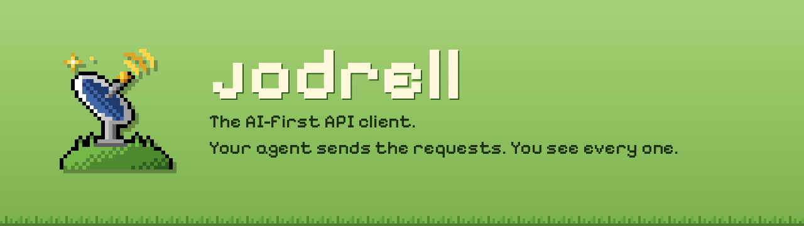
</p>

<p align="center">
  <a href="https://github.com/danneh150/jodrell/actions/workflows/ci.yml"></a>
  <a href="LICENSE"></a>
  
  
</p>

**jodrell is the AI-first API client:** an alternative to Postman, Bruno and Insomnia, built for working through an AI coding agent.

Other API clients are apps you work in, with AI added to help you. jodrell turns that around. **Your agent does the API work**, and jodrell makes sure you can see every request it makes and step in at any point:

- It lives in your project, and your agent uses it through MCP.
- Requests, collection runs and the timeline come back in the agent's replies.
- A full GUI and an HTML report are there whenever you want them.

Every request, yours and your agent's, goes into one history you can browse, compare, replay and save.

It's named after **Jodrell Bank**, the observatory in Cheshire whose giant dish has listened to signals from deep space since 1957. Back then, it was the only telescope in the West that could track the rocket that launched Sputnik 1. jodrell does the same for your agent: everything it sends and receives is picked up and shown to you. The pixel-art icon is a nod to the dish.

<p align="center">
  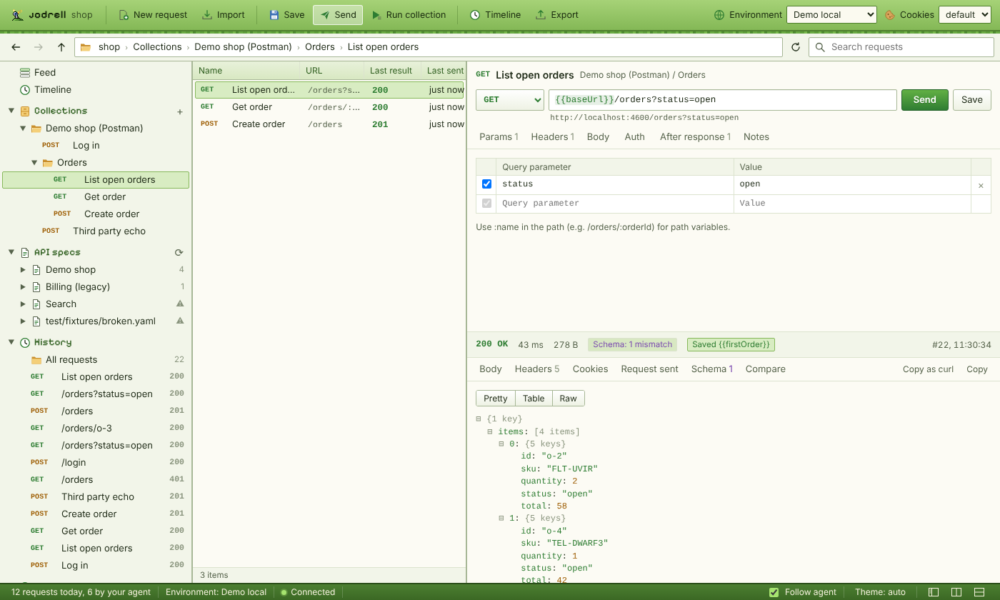
</p>

## Contents

- [Why jodrell](#why-jodrell)
- [Features](#features)
- [How it compares](#how-it-compares)
- [Screenshots](#screenshots)
- [Quick start](#quick-start)
- [How it works](#how-it-works)
- [A tour](#a-tour)
- [Making sure your agent uses jodrell](#making-sure-your-agent-uses-jodrell)
- [The GUI](#the-gui)
- [Postman collections](#postman-collections)
- [Your API specs](#your-api-specs)
- [Variables, auth and cookies](#variables-auth-and-cookies)
- [Reference](#reference): [configuration](#configuration), [commands](#commands), [agent tools](#agent-tools)
- [Privacy and security](#privacy-and-security)
- [Testing](#testing)
- [Development](#development)
- [Known limits and plans](#known-limits-and-plans)
- [Credits and licence](#credits-and-licence)

## Why jodrell

More and more API work now happens through coding agents: calling an endpoint to check a fix, logging in to a third-party API, or running through a flow. Traditional API clients weren't designed for that. They expect you to do the clicking.

When an AI agent works with APIs, it usually reaches for `curl`. The requests scroll past in the terminal, half the response is cut off, and there's no record of what was sent, what came back, or which token it used. If you want to try the request yourself, you're copying it into Postman, a separate app with its own copy of your API definitions.

jodrell gives you and your agent one shared place for API work:

- **The agent makes requests through jodrell,** so every request is recorded, with secrets masked.
- **You see them as they happen:** in the agent's reply, in a GUI next to the agent, or as a timeline.
- **You can pick up where the agent left off:** open any request, edit it, send it again, compare it with an earlier one, or save it to a collection.
- **It already knows your APIs.** It finds the OpenAPI specs in your project, checks responses against them, and imports your Postman collections.

## Features

- 🛰️ **Works through your agent:** over 20 MCP tools for sending requests, running collections, browsing history and more. Requests, collection runs and the timeline come back as interactive views inside the reply in hosts that support [MCP Apps](https://modelcontextprotocol.io), such as Claude Desktop and VS Code.
- 🔒 **Keeps the agent honest:** in Claude Code, a guard redirects the agent's direct `curl`, `wget` and `fetch` calls to jodrell, so nothing slips past the history.
- 🗂️ **A full API client:** collections and folders, a request builder (params, headers, every body type, auth, captures, expected status), curl paste, compare, replay, environments and a collection runner.
- 📬 **Imports Postman:** collections (v2.0 and v2.1) and environments, with common test-script lines converted into built-in captures and checks.
- 📄 **Finds your specs:** every OpenAPI and Swagger spec in the project, plus one your running app serves, reloaded when they change. Responses are checked against them.
- 🕰️ **A history you can use:** a timeline by day and session, a live feed, and a self-contained HTML report that works offline.
- 🪟 **A GUI with character:** an Explorer-style layout with no tabs, drafts kept automatically, a green meadow theme with pixel touches, and dark mode. It runs in a browser or in your terminal next to the agent.
- 🏠 **Local and private:** everything stays in your project's `.jodrell/` folder, with no account, cloud or telemetry.

## Screenshots

<table>
<tr>
<td width="50%" valign="top"><a href="docs/images/timeline.png">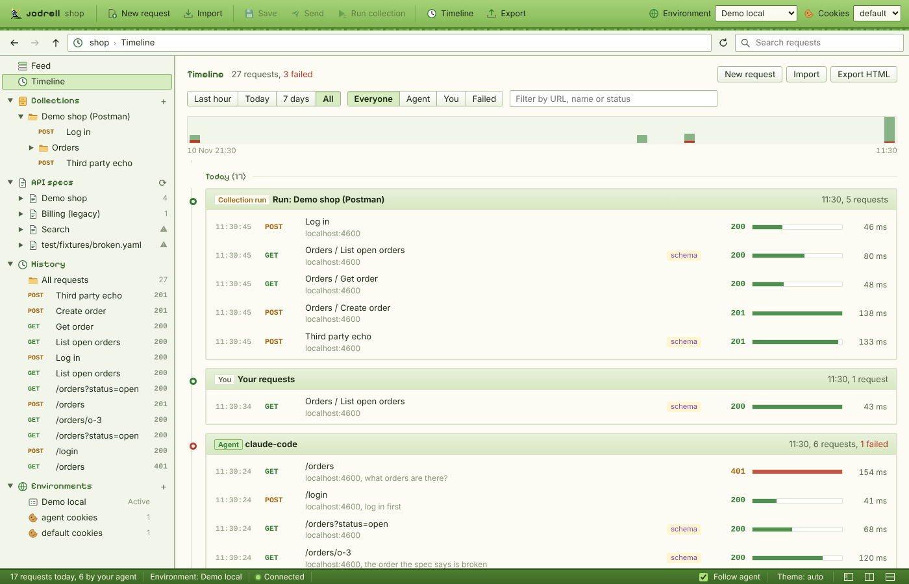</a><br><sub><b>Timeline</b>: every request by day and session, with failures and schema problems marked</sub></td>
<td width="50%" valign="top"><a href="docs/images/agent-view.png">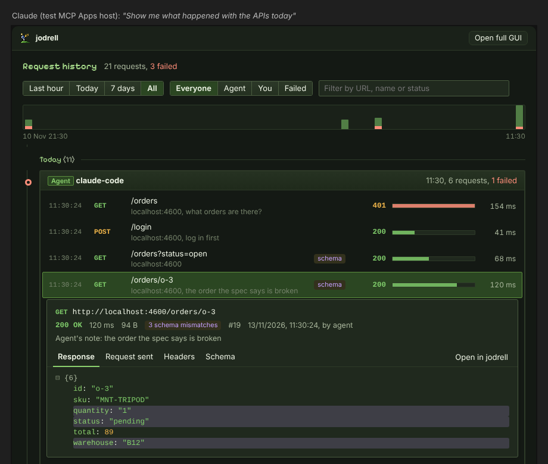</a><br><sub><b>In your agent's reply</b>: the same timeline, with any request expandable</sub></td>
</tr>
<tr>
<td width="50%" valign="top"><a href="docs/images/gui-feed-dark.png">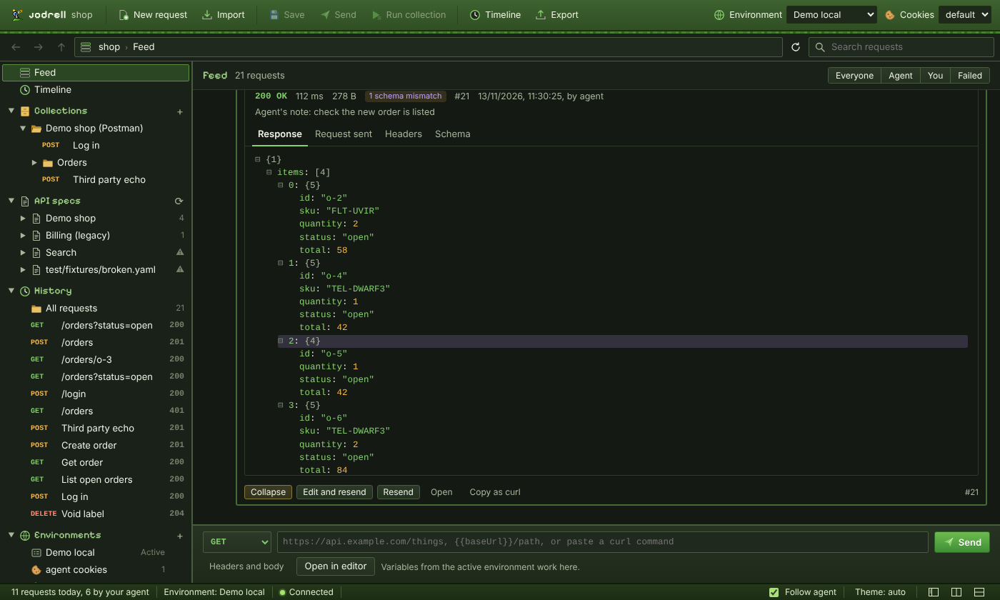</a><br><sub><b>Feed</b>: everything you and your agent send, live, in dark mode</sub></td>
<td width="50%" valign="top"><a href="docs/images/compare.png">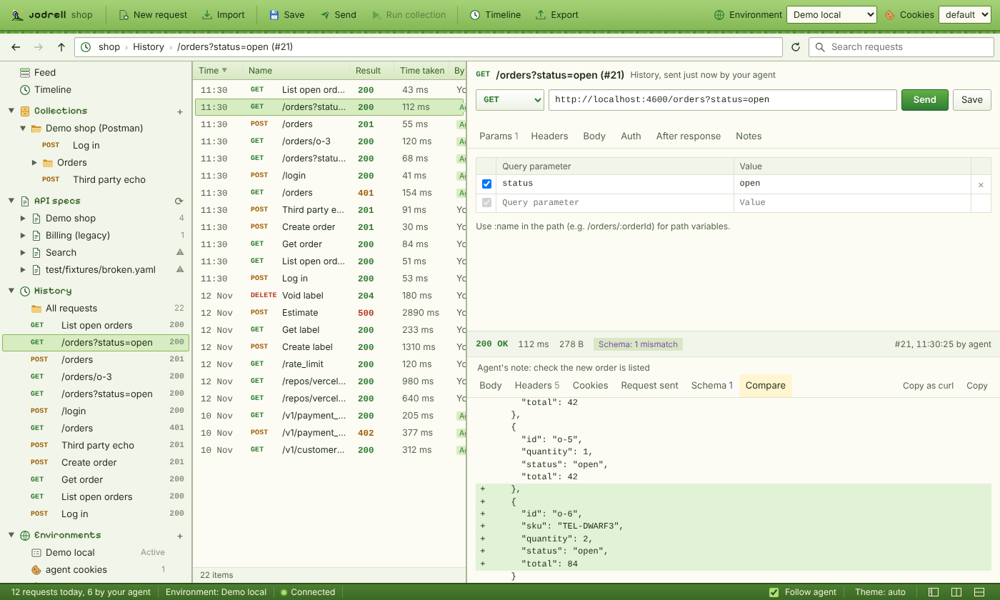</a><br><sub><b>Compare</b>: what changed between two responses</sub></td>
</tr>
<tr>
<td width="50%" valign="top"><a href="docs/images/collection-run.png">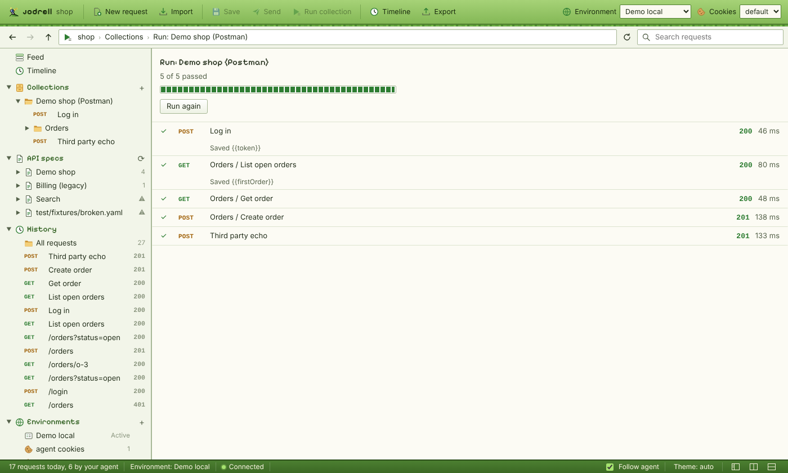</a><br><sub><b>Collection runs</b>: pass or fail for every request, with captured values</sub></td>
<td width="50%" valign="top"><a href="docs/images/schema.png">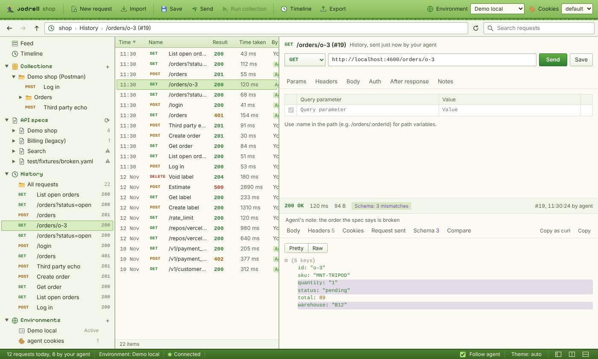</a><br><sub><b>Schema checks</b>: responses checked against your OpenAPI spec</sub></td>
</tr>
<tr>
<td width="50%" valign="top"><a href="docs/images/timeline-dark.png">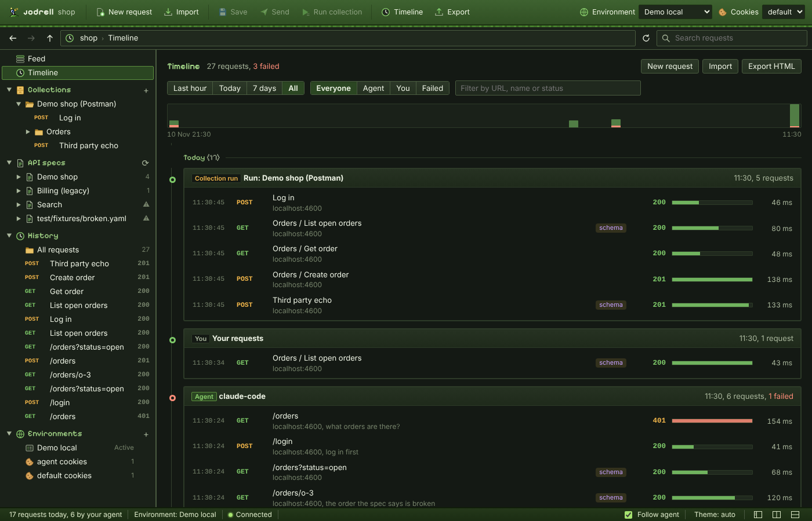</a><br><sub><b>Night meadow</b>: the dark theme</sub></td>
<td width="50%" valign="top"><a href="docs/images/narrow.png">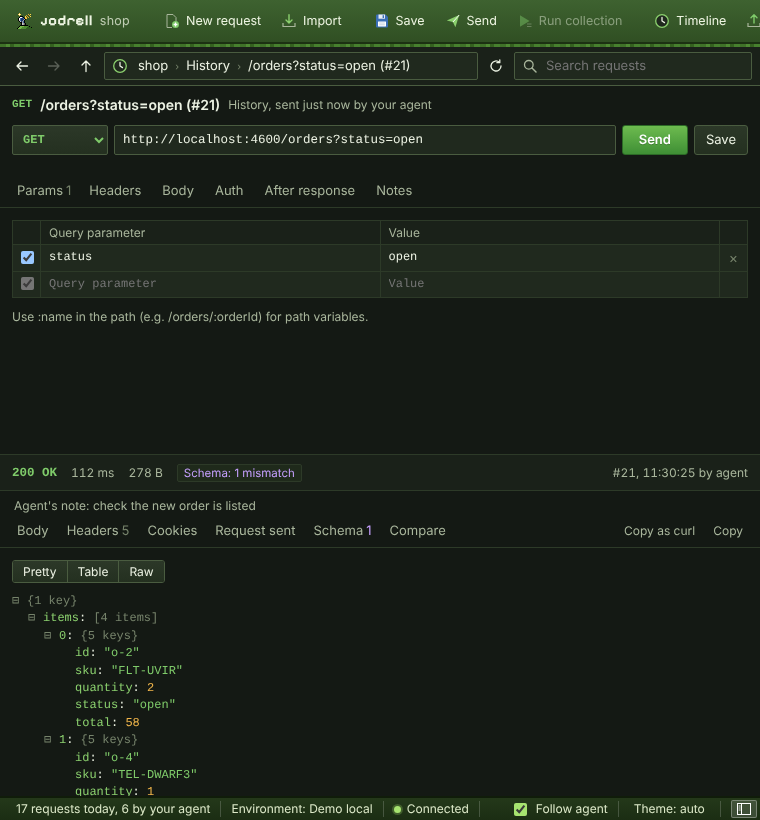</a><br><sub><b>Next to your agent</b>: the layout at terminal-pane width</sub></td>
</tr>
</table>

<sub>Screenshots use the bundled demo API and example data, and are regenerated by <code>assets/screenshots.py</code>.</sub>

## How it compares

Postman, Bruno and Insomnia are excellent **API clients for people**, and all of them now have AI features. jodrell is an **API client for your agent**, with you watching and stepping in. Here's how it compares with the two most common choices (as of November 2026):

| | **jodrell** | **Postman** | **Bruno** |
| --- | --- | --- | --- |
| **Built for** | Working through an AI coding agent, with you watching and stepping in | Teams that want shared cloud workspaces, mocks and monitoring | Git-first, offline teams |
| **Who sends the requests** | Mostly your agent, and you whenever you want | You, helped by Agent Mode | You, helped by Bruno AI (beta) |
| **How agents connect** | Built in: over 20 MCP tools, set up by `npx jodrell init` | The official Postman MCP server (needs an account and API key) | Community MCP servers |
| **Where it runs** | In your project, started by your agent; GUI in a browser or the terminal | Desktop and web app, with cloud workspaces | Desktop app, offline |
| **Account** | None | Needed to collaborate; the Free plan is for one user | None |
| **Collections** | In `.jodrell/` in the project (files in git are planned) | Cloud workspaces, with Git support | Plain-text files in your repo |
| **Your API specs** | Found anywhere in the project and kept up to date; responses checked against them | Spec Hub | Imported |
| **Postman collections** | Imported; common script lines converted (scripts aren't run) | Native | Imported |
| **Licence** | MIT | Proprietary | MIT |

**What's different about jodrell:** every request your agent makes is recorded and shown to you: in its replies, a live feed, a timeline and an HTML report. In Claude Code, a guard routes the agent's `curl` and `fetch` calls through jodrell, so nothing slips past.

**Where jodrell is behind today:**

- **Protocols:** HTTP only (REST, plus GraphQL over HTTP). No WebSockets, gRPC, MQTT or MCP requests yet.
- **Teams:** no shared workspaces, and collections aren't files you can review in git yet.
- **No mocks, monitors or CI runner.**
- **Scripts aren't run.** Pre-request and test scripts are converted where possible, not executed.

If your team lives in shared workspaces, or needs protocols beyond HTTP, Postman or Insomnia may suit you better. If your collections are reviewed in git, Bruno does that well today. If your API work increasingly happens through an agent, jodrell is built for exactly that, and it imports your Postman collections, so you can use both.

## Quick start

You need Node 22.13 or newer.

```bash
npm i -D jodrell
npx jodrell init
```

Then restart your agent (or reload its MCP servers) and approve `jodrell` when asked.

`init` does five things:

- registers jodrell with your agent: `.mcp.json` for Claude Code, plus Cursor and VS Code if you use them
- tells the agent to use it (in `CLAUDE.md`, plus `AGENTS.md` and Cursor's rules when present)
- pre-approves its tools and adds the guard in `.claude/settings.json`
- git-ignores `.jodrell/`
- lists the API specs it found

Now ask your agent things like:

> *"Call GET https://api.github.com/repos/vercel/next.js and show me the response."*
>
> *"Import ./postman/shop.json with its environment, then run the Orders folder."*
>
> *"Log in to our API as the test user, save the token, then list my orders."*
>
> *"Show me today's request history."*

To open the full GUI at any time:

```bash
npx jodrell gui            # in your browser
npx jodrell gui --pixel    # in a terminal split next to your agent
```

> [!TIP]
> You don't need to keep anything running. Your agent starts jodrell when it needs it, and the GUI connects to the same project history, even from another terminal.

## How it works

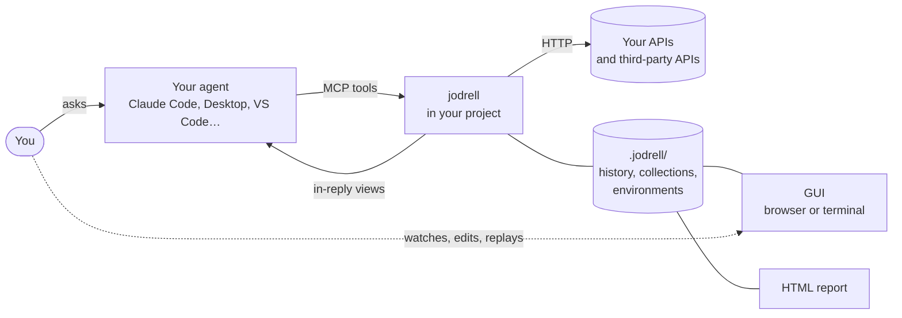

jodrell is a small Node package with no service behind it. Your agent runs it over stdio as an MCP server. It sends requests on the agent's behalf, records them in a SQLite database in `.jodrell/`, and starts a local GUI server so its replies can link to each request. Anything else you open (the GUI in a browser, a Pixel pane, `watch`, a report) reads the same history, so they stay in step even across processes.

## A tour

### In your agent's replies

In hosts that support MCP Apps, requests, collection runs and the timeline appear right in the conversation. You can expand any request to see its response, what was sent, its headers and any schema problems, or jump to the full GUI.

<p align="center"></p>

<table>
<tr>
<td width="50%" valign="top"><a href="docs/images/agent-request.png">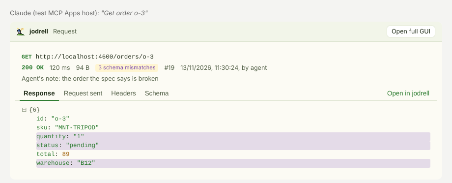</a><br><sub>A single request, with its schema mismatches</sub></td>
<td width="50%" valign="top"><a href="docs/images/agent-run.png">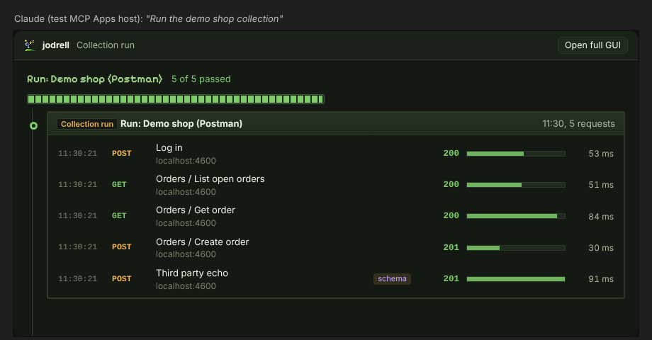</a><br><sub>A collection run: 5 of 5 passed</sub></td>
</tr>
</table>

<sub>Shown in a test host that implements the MCP Apps protocol.</sub>

In terminal agents like Claude Code, you get the same information as text, with a link to that request in the GUI. Ask the agent to "open jodrell" and it opens the GUI next to it.

### The feed

The home view is every request as a card in one stream, with the newest at the bottom and your agent's marked with a robot. Expand a card for the full response, **Edit and resend** it in place, or use the composer at the bottom for a quick request. You can paste a curl command there too.

<p align="center"></p>

### The timeline

The timeline shows your history by day and session: agent conversations, your own requests and collection runs. A histogram shows when things happened, with failures in red, and bars compare how long each request took. Long gaps, failed checks and schema mismatches are marked.

<p align="center"></p>

Filter by time (last hour, today, 7 days, all), by who sent it (you, your agent, or only failures), or by text. Click any request to open it.

### The HTML report

`npx jodrell report --open`, the **Export** button, or asking your agent, gives you the whole timeline as one self-contained file (about 150 kB). It works offline, so you can attach it to a pull request or a bug report. Secrets are masked.

<p align="center">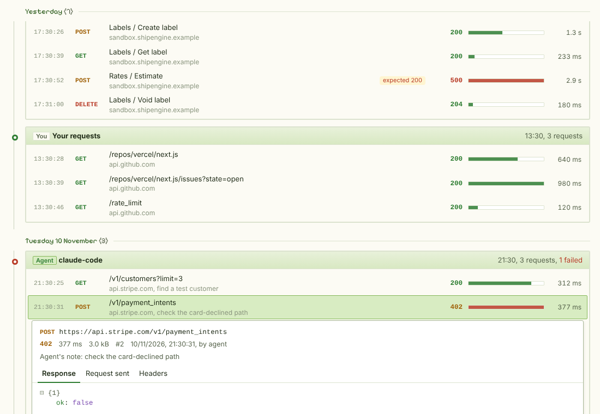</p>

## Making sure your agent uses jodrell

`init` sets up three layers:

1. **It tells the agent.** A short section in `CLAUDE.md` (and `AGENTS.md`, Copilot's instructions and Cursor's rules, when present) says to make HTTP requests with jodrell's tools. It's kept between `<!-- jodrell:start -->` markers, so you can edit around it, and `init` updates it in place.
2. **It makes jodrell the easy path.** jodrell's tools are pre-approved in `.claude/settings.json`, so the agent never stops to ask before using them.
3. **It enforces it, in Claude Code.** A guard hook checks each shell command before it runs:
   - **API calls are blocked:** `curl`, `wget -qO-`, HTTPie, xh, and inline Node or Python fetches. The agent is told to use `send_request` with the same URL instead.
   - **Everything else runs as normal:** downloads (`curl -o`, `wget file.zip`), install scripts (`curl … | sh`), `git clone`, and reading documentation on the web.
   - **It's fast:** it adds about 30 ms per command.

To change the guard, set `"guard": "ask"` in `jodrell.config.json` to be asked each time, or `"off"` to turn it off. A command prefixed with `JODRELL_ALLOW=1` always runs; the agent is told to use that only when you explicitly ask. Restart Claude Code after changing hooks.

> [!NOTE]
> This covers requests the agent makes. Requests made by code the agent runs (your tests, scripts, or the app itself) don't pass through the agent's tools. A recording proxy for those is on the [plans](#known-limits-and-plans).

## The GUI

The GUI looks like Windows File Explorer, in a green "meadow" theme with a hint of pixel-art games. It has light and dark themes and works at any width, including a narrow terminal pane.

- **No tabs.** One thing is open at a time, and you move around with the tree, back, forward and Up (`Alt`+arrows), breadcrumbs and search.
- **Drafts are kept automatically.** Edit a request, open something else, even close jodrell: your edit is still there. Drafts are marked with a dot and collected under **Unsaved requests**. Use **Save** to keep a draft in its collection, or **Revert** to drop it.

  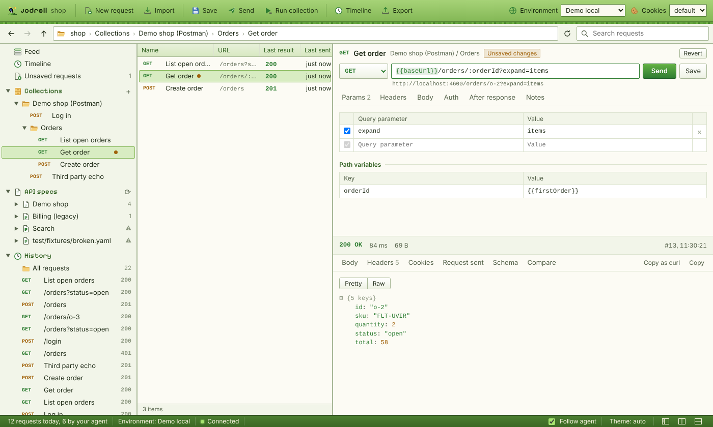
- **Three panes.** Select a collection, folder, spec or History, and you get a Details list (name, URL, last result, last sent) with the selected request on the right. The arrow keys move through the list and preview each request.
- **A request builder:**
  - **Params and path variables,** kept in sync with the URL
  - **Headers**
  - **Bodies:** JSON, text, XML, form, multipart and GraphQL
  - **Auth:** inherit, bearer, basic or API key
  - **After response:** save values from the response into variables, and check the expected status
  - **Notes**

  `{{variables}}` are coloured as you type (green if they'll resolve, red if not), with the final URL shown underneath. You can paste a curl command into the URL bar.
- **The response:**
  - **Body:** a tree, a table or raw text
  - **Headers and cookies,** with cookies masked
  - **Request sent:** exactly what went out, after variables and auth
  - **Schema:** problems, highlighted on the exact field
  - **Compare:** a diff against any earlier response
- **Following your agent.** Its requests appear live in the feed and timeline. While you're browsing History, the newest is selected. If you're editing something, you get a notification instead of being interrupted.

**Shortcuts:**

| Keys | Action |
| --- | --- |
| `Ctrl`/`⌘`+`Enter` | Send |
| `Ctrl`/`⌘`+`S` | Save |
| `Ctrl`/`⌘`+`N` | New request |
| `Alt`+`←`/`→` | Back and forward |
| `F5` | Refresh |
| `↑`/`↓` | Move through a list |

<table>
<tr>
<td width="50%" valign="top"><a href="docs/images/schema.png"></a><br><sub>Schema problems, highlighted on the exact field</sub></td>
<td width="50%" valign="top"><a href="docs/images/compare.png"></a><br><sub>Compare: the order the agent created, in green</sub></td>
</tr>
</table>

**In the terminal.** `npx jodrell gui --pixel` (or `npx jodrell open` for the current pane) shows the same GUI inside your terminal using [Pixel](https://pixelgui.com):

- **Terminals:** Ghostty, iTerm2, WezTerm, kitty and tmux, among others
- **Install:** it comes with `npm install` as an optional dependency, and downloads its own Chromium
- **Fallback:** if it isn't available, jodrell opens your browser instead
- **Linux:** Pixel won't run as root

<p align="center"></p>

## Postman collections

Import with `npx jodrell import <file>`, the **Import** button (drag and drop works), or by asking your agent. Collections v2.0 and v2.1 are supported, and so are environment exports.

What comes across:

- folders, and the order of requests
- methods, URLs, query parameters and `:path` variables
- headers, including disabled ones
- raw, URL-encoded, form-data and GraphQL bodies
- bearer, basic and API key auth, at request, folder and collection level
- collection variables and descriptions

**Scripts aren't run.** jodrell never executes collection code. Instead, it converts the lines people use most:

- `pm.environment.set("token", pm.response.json().access_token)` (and the `collectionVariables`, `globals` and header variants) becomes a **save from the response** rule
- `pm.response.to.have.status(201)` and its common variants become an **expected status** check

Anything else is kept, read-only, on the request, and the import tells you how many lines it skipped.

<table>
<tr>
<td width="50%" valign="top"><a href="docs/images/import.png">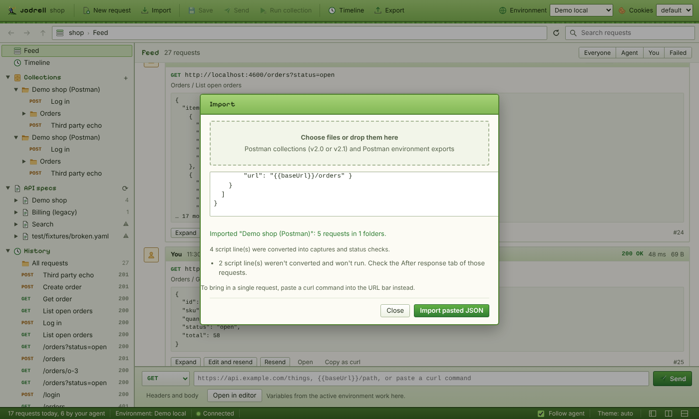</a><br><sub>Importing: what was converted, and what wasn't</sub></td>
<td width="50%" valign="top"><a href="docs/images/collection-run.png"></a><br><sub>Running it: the login token flows into later requests</sub></td>
</tr>
</table> Not supported yet: file uploads in multipart bodies, binary bodies, OAuth 2, and collection-level scripts. They're flagged on import.

## Your API specs

jodrell searches your whole project for OpenAPI 3.x and Swagger 2.0 specs:

- **By content:** it recognises specs by their contents, not their filenames, so generated specs are found wherever your app writes them.
- **Skipped:** `node_modules`, `.git`, build caches and virtual environments.
- **Duplicates:** if the same spec is in more than one place, the newest copy wins.
- **Broken specs:** a spec that won't parse is reported, and the rest still load.
- **Live reloading:** a regenerated spec reloads within a couple of seconds. New spec files are picked up within 30 seconds, or straight away with **Reload** (or by asking the agent).

**Specs your app serves.** Many frameworks (FastAPI, NestJS, Spring and others) only produce the spec at runtime. Run `npx jodrell init --app-url http://localhost:3000`, and jodrell checks the usual paths (`/openapi.json`, `/v3/api-docs`, `/api-json` and more), picking the spec up when the app starts.

**Base URLs.** jodrell uses the first of these that exists:

1. a per-spec `baseUrl` in your config
2. the spec's own server URL, if it's absolute
3. a relative server URL (like `/api`), resolved against `appUrl`
4. `appUrl` itself

If it can't work one out, it tells you and the agent, rather than guessing.

Your agent can call operations by name (`call_operation`), and every response, from any tool, is checked against the matching spec.

<p align="center">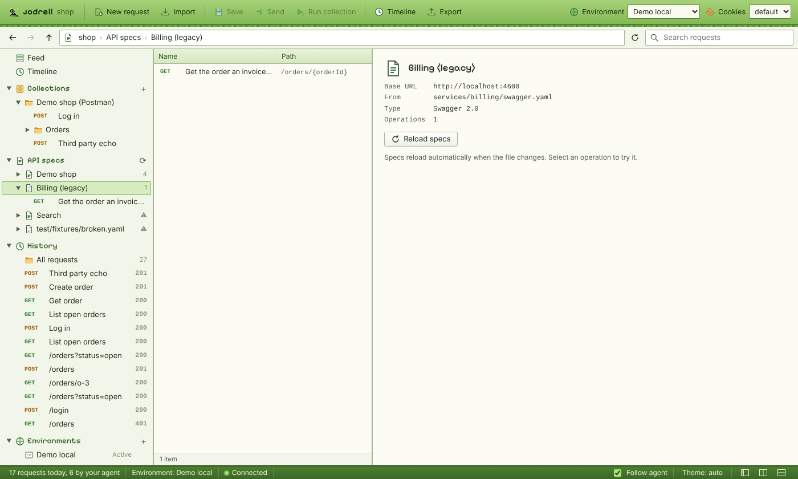</p>

## Variables, auth and cookies

- **`{{variables}}`** work in URLs, path variables, headers, bodies and auth fields:
  - **Precedence:** collection variables, then the active environment, then session variables, then one-off overrides, with later ones winning.
  - **Generated values:** `{{$guid}}`, `{{$timestamp}}`, `{{$isoTimestamp}}` and `{{$randomInt}}` are generated when the request is sent.
  - **Missing variables:** the request isn't sent, and you're told which variable is missing.
- **Saving from responses:** values saved after a response go into the active environment, or the collection if no environment is active, as Postman would do.
- **Cookies are kept per host,** in a named session ("default" in the GUI). A cookie only goes back to the domain that set it.
- **Captured auth headers** are tied to the host that issued them too, so a token from one API is never sent to another.

## Reference

### Configuration

This is all optional. Put it in `jodrell.config.json`, or under a `"jodrell"` key in `package.json`:

```json
{
  "appUrl": "http://localhost:3000",
  "specs": [{ "path": "services/billing/openapi.json", "baseUrl": "http://localhost:4000" }],
  "discover": true,
  "guard": "block",
  "port": 4545
}
```

| Key | Default | What it does |
| --- | --- | --- |
| `appUrl` | none | Your running app. It's checked for a served spec, and used as the base URL for specs without one. |
| `specs` | none | Specs to add or pin, as paths, URLs or `{ path, baseUrl }`. Listing specs turns discovery off unless `discover` is `true`. |
| `discover` | `true` (unless `specs` is set) | Search the project for specs. |
| `baseUrl` | `appUrl` | The fallback base URL for specs without one. |
| `guard` | `"block"` | `"block"`, `"ask"` or `"off"`: what the Claude Code guard does with direct API calls. |
| `port` | `4545` | The GUI port. Another is used automatically if it's taken. |

### Commands

| Command | What it does |
| --- | --- |
| `npx jodrell init` | Set up the project. `--app-url <url>` adds your app; `--no-guard` and `--no-rules` skip those parts. |
| `npx jodrell gui` | Open the GUI in your browser. `--pixel [right\|down]` opens it in a terminal split; `--no-open` starts it without opening anything. |
| `npx jodrell open` | Show the GUI in this terminal pane (Pixel). |
| `npx jodrell report` | Write the history as an HTML file. `--since 24h`, `--out file.html`, `--open`. |
| `npx jodrell import <file\|url>` | Import a Postman collection or environment. |
| `npx jodrell watch` | Stream requests into the terminal as they happen. Add `--detail` for full bodies. |
| `npx jodrell show <n>` | Print request number `n` in full. |
| `npx jodrell mcp` | Run as an MCP server over stdio. This is what your agent starts. |
| `npx jodrell guard` | The Claude Code hook. `init` sets this up for you. |
| `npx jodrell mcp-config` | Print how to connect other MCP clients. |

### Agent tools

| Tool | What it does |
| --- | --- |
| `send_request` | Call any URL, including third-party APIs, with optional session, captures and a note. Shows a request view. |
| `call_operation`, `list_operations`, `describe_operation` | Your own APIs, from the specs in the project, with schema checks. |
| `list_specs`, `reload_specs` | See which specs were found (and any problems), or rescan now. |
| `run_request`, `run_collection` | Run saved or imported requests, or a whole collection or folder, with pass/fail per request. Shows a view. |
| `import_collection`, `list_collections`, `describe_request`, `save_request` | Postman import, browsing collections, and saving a request (or one already made) for you. |
| `list_environments`, `use_environment`, `set_variable` | Environments and variables. Secret-looking values are masked. |
| `set_session`, `list_sessions` | Cookie jars and auth headers, scoped to a host. |
| `show_history`, `show_request` | Show the timeline or one request in the reply. |
| `get_history`, `get_call`, `start_run` | Read back earlier requests (long bodies come in pages), and group the next calls under a name. |
| `export_report`, `open_gui` | Write the HTML report, or open the GUI next to the agent or in the browser. |

## Privacy and security

- **Local only.** Everything lives in `.jodrell/` in your project: the history database, collections, environments and reports. `init` git-ignores it. Nothing is sent anywhere except the requests you and your agent make. There's no telemetry, and no fonts or scripts are loaded from the web.
- **Secrets are masked** before they reach the history, the GUI, agent replies or reports. That covers authorisation headers, API keys, anything named like a token or secret, and cookie values in full.
- **The GUI server** listens on `127.0.0.1` only, and refuses requests from other websites.
- **Responses never run.** HTML or scripts in an API response are shown as text everywhere, including the report.
- **Variables are stored as typed,** as in Postman. Keep secrets in environment variables, not in requests, and treat `.jodrell/` like a local `.env` file.

See [SECURITY.md](SECURITY.md) to report a problem.

## Testing

```bash
npm test                 # about 125 unit and integration tests, around 15 seconds, no network
npm run test:coverage    # with a coverage report (about 96% of lines)
```

The automated tests cover:

- import, variables, auth, cookies and sessions
- spec loading and discovery
- the guard
- the GUI's HTTP API
- every agent tool, through a real MCP client
- the command line
- several processes sharing a project

What needs a real agent, host, terminal or person is in the end-to-end plan, [`docs/testing/E2E.md`](docs/testing/E2E.md): 127 cases, of which 33 are a smoke test to run before each release. See [`docs/testing/README.md`](docs/testing/README.md) for how the tests are organised.

## Development

```bash
git clone https://github.com/danneh150/jodrell && cd jodrell
npm install
npm test
npm run demo            # a demo shop API on :4600 (password: secret)
npm run fake-api        # the test suite's fake API on :4610
npx jodrell gui          # the GUI, with this folder as the project
```

The `examples/` folder has a demo spec, a Postman collection and environment, and scripts that act as an agent (`npm run try-agent`).

The code is plain JavaScript (ES modules) with a handful of runtime dependencies: the MCP SDK and MCP Apps, zod, a YAML parser, and Ajv for schema checks. The database is Node's built-in SQLite, and the GUI has no build step. See [CONTRIBUTING.md](CONTRIBUTING.md) for how the code is laid out.

**The icon and banner** are pixel art drawn by code. Change them in `assets/icon-source.py` and `assets/banner.py`, then run them with Python and Pillow to regenerate every size.

**The screenshots** are generated too. `python3 assets/screenshots.py` builds an example project, starts the demo API and the GUI, and photographs every view in `docs/images/`. It needs Python, Pillow and Playwright (`pip install playwright pillow && python -m playwright install chromium`). Run it after changing the GUI, so the README never goes stale.

## Known limits and plans

**Known limits:**

- **The agent's own requests only.** Requests made by code the agent runs (tests, scripts, your app) aren't captured yet.
- **Postman gaps:** multipart file uploads, binary bodies, OAuth 2 and collection-level scripts aren't supported.
- **The in-reply views** have been tested against the MCP Apps protocol in a test host. Real hosts can differ in details, so please report anything odd.

**Ideas for what's next:**

- a **recording proxy**, so requests from your app and tests appear in the timeline too
- **collections as files in the repo**, so a team can share them through git and review changes
- **exporting** collections back to Postman format
- **notebooks:** runbooks of notes and requests that run top to bottom

## Credits and licence

- **The icon** is original pixel art. **The heading font** is [Pixelify Sans](https://github.com/eifetx/Pixelify-Sans), © The Pixelify Sans Project Authors, under the SIL Open Font License (see `ui/fonts/OFL.txt`).
- **Built on** the [Model Context Protocol](https://modelcontextprotocol.io) SDK and [MCP Apps](https://github.com/modelcontextprotocol/ext-apps). The in-terminal GUI uses [Pixel](https://pixelgui.com).
- **Licence:** MIT. See [LICENSE](LICENSE).
- **Not affiliated** with Jodrell Bank Observatory or the University of Manchester. The name is a tribute.
